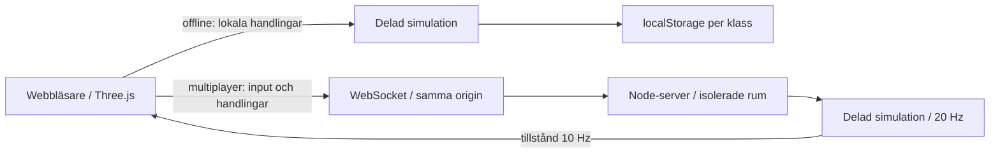

# Arkitektur

Klienten renderar spelvärlden med Three.js. `shared/game.js` är en DOM-fri simulation som används både av offlinespelaren och Node-servern. Klienten skickar rörelse/siktning och begär handlingar; den skickar inte position, träffresultat, skada, inventarie eller XP som servern accepterar.

## Kontrakt

- `join`: rumskod, obligatoriskt unikt visningsnamn, klass och valfri `stateAck`. Servern genererar spelar-ID och alla startvärden.
- `input`: x/z i intervallet −1…1, siktningsvinkel, vertikal siktning samt avfyrning, sprint, hukning och sikte. Rörelse normaliseras; NaN, Infinity och oväntade typer neutraliseras. Utebliven input i 500 ms stoppar rörelse/avfyrning.
- `action`: omladdning, klassförmåga, loot, utrustning, skrotning, läkning, talang, PvP-val, uppdrag, tillverkning, rustningsköp eller återkomst efter död. Servern kontrollerar ägarskap, avstånd, saldo, hälsa och nedkylning.
- `admin`: exakta namnet AdminL ger socketens spelare rätt att skapa föremål och ändra validerade statistikfält för en spelare i samma rum. Namnet är avsiktligt ingen autentisering.
- `ack`: webbklienten kvitterar sekvensnumret på varje tillstånd. Servern håller högst ett okvitterat tillstånd per klient och skickar det senaste efter kvittens; långsamma flikar bygger ingen gammal snapshotkö. Äldre klienter utan `stateAck` får ordinarie utskick.
- `welcome` / `state`: serverns tillstånd. Renderingen interpolerar enheter visuellt. Klientprediction, rollback och laggkompensation är inte implementerade; hög latens märks i spelkänslan.
- Max åtta spelare per rum, 32 rum, 256 anslutningar, 2 KiB per meddelande och 100 klientmeddelanden/s. Ej anslutna spelare stängs efter 10 sekunder. Rumsdata rensas när alla anslutningar stängts.
- Kontroller av browser-origin är same-origin, eller det uttryckliga `ALLOWED_ORIGIN` bakom HTTPS-proxy. Detta ersätter inte autentisering. I lokalt läge tillåts verktyg utan Origin-header.

Servern skickar rummets tillstånd till alla deltagare. Servern avgör träffar och progression, men klienter kan läsa fiendepositioner och andra spelares tillstånd. Det finns inget fullständigt anti-cheat eller dolt informationslager. Kollisions- och siktlinjetester använder samma förenklade byggnadsytor i båda spellägena. Skott använder tredimensionella strålar, spelarens ögonhöjd och byggnadernas/hindrens höjd. Gemensam Copernicus-terräng används för mark, ögonhöjd och skott. Trädstammar, stenblock och 180 deterministiskt placerade omgivningshus har kollision och blockerar skott. Husen kan inte beträdas. Rörelse går långsammare i terräng och på branta sluttningar. AI använder A* på ett fyrametersrutnät, testar hela segment mot gångbara ytor och lagrar vägar utanför nätverkssnapshots. Sökningen är begränsad till 2 200 noder och två nya sökningar per rum/tick. Fiender patrullerar och prioriterar en aktuell angripare inom räckvidd. Detta är inte en fullständig navmesh; trånga passager mindre än rutnätet kan saknas.

## Sparning

Offline sparas versionerat JSON under `avesta-save-v1-<klass>`. Vapenstatistik rekonstrueras från typ/sällsynthet/nivå när sparningen läses; trasiga poster ignoreras. Offlineprofilen är användarägd och kan ändras i webbläsaren, vilket är en anledning till att den aldrig laddas in i multiplayer. Lagerutrymmesfel visas i gränssnittet.

Uppdragskedjan, tillverkade vapen och rustningsnivån ingår i samma offlineformat; äldre version 1-sparningar får tom kampanj och rustning 0. Verkstaden kontrollerar avstånd till Maja, serverbestämda priser, packningskapacitet och maxnivå. Uppdragsbelöningar betalas endast en gång per steg.

Multiplayer är flyktig och har ingen databas. En WebSocket-reconnect skapar en ny karaktär. Publicering av molnmiljön sparar filer och installerade beroenden, inte pågående matcher eller serverprocesser.

## Offlineleverans

`npm run build` skapar klienten och en innehållsversionerad service worker som precachar alla byggresurser. Ingen CDN används. När den cachelagrade produktionsklienten har laddats en gång på en säker origin kan den laddas om utan internet. `/health` och `/ws` cachas inte. Uppdaterade service workers aktiveras efter att den gamla klientens flikar stängts. Lokalt sparade karaktärer ligger utanför cachen och påverkas inte av en cacheuppdatering.

## Utvecklingsmiljö

Node 24, låsta npm-beroenden, Chromium och vanliga shellverktyg räcker. npm-cache och lokala testartefakter ligger i `.local/` och versionshanteras inte. Inga hemligheter behövs. Molnuppgifter har redan isolerade utcheckningar; använd befintlig utcheckning och skapa inte Git-worktrees om det inte uttryckligen efterfrågas.

## Kartdata

`data/avesta-osm.json` innehåller det daterade OSM-utdraget. `node scripts/build-map.js` projicerar det deterministiskt till `shared/geography.json`. `shared/map.js` använder samma vägar, vatten och landmärken på klient och server. Geografiska avstånd komprimeras 1:4. Vattenytor används där de finns; älvlinjer får förenklade bredder. Vägbroar tillåter passage genom vattenkollisionen. Sex landmärkespositioner kommer från OSM; två är märkta som ungefärliga. Byggnadsmodellerna är fortfarande tolkningar.

Version 0.4 delar även vapendefinitioner, fiendefamiljer och NPC-tjänster mellan klient och server. Granater simuleras auktoritativt med stubin, förenklade studsar, sikttest och PvP-kontroll. Inställningar är lokala presentationsval och ger inte klienten rätt att ändra spelstatistik. Spanarens kartmarkeringar är en spelregel, inte nätverkssekretess: klienten får fortfarande fiendetillstånd.

## Utrustning och interiörer (0.5)

`shared/items.js` definierar material, vapendelar, passform och modifierade vapenegenskaper. `shared/economy.js` hanterar serverägda priser/recept, begränsade lager, handel, personliga söklådor och arkivuppdraget. `shared/talents.js` definierar talangkedjor, alternativa grenar och klassförmågor. `shared/interiors.js` delar Aaltohusets väggar, bjälklag och golvnivå mellan gångkollision, raycasts och modellen. `src/landmarks.js` innehåller egenbyggd fototolkad geometri. Ingen tredjepartsbildtextur eller ny extern drifttjänst behövs.

Specialiserade tester täcker fördelning av drops, ekonomi, materialkostnader, kapacitet, kompatibilitet, magasin/omladdning, talangförutsättningar, alla klassers specialförmågor, interiörkollision och sparmigrering. Webbläsartester genomför handel/montering/talangval och går via tangentbordsstyrning in i Aaltohuset på en riktig multiplayer-server.

## Kampanj och klassutbyggnad i 0.6

`shared/story.js` äger de åtta kapitlen, fem arbetsplatserna, uppdragsmål och tidsstyrd interaktion. `progression.js` behåller kampanjstatus, boss-/besöksspårning och äldre sparformat. `story` valideras i `act`; `tickStory` körs efter striden så skada och död kan avbryta samma tick som arbetet skulle avslutas. Aktiv arbetstid skickas i snapshots men sparas inte offline. Belöningar lämnas en gång hos Maja. Journalens upplåsta innehåll härleds ur kampanjsteget, aldrig ur klientens textval.

`shared/class-skills.js` innehåller sex klassers nya noder, vapenmodifierare och `tactical`-handlingar. `talents.js` validerar poäng/föräldrar/klass även vid återläsning; simulationen tillämpar rörelse, återhämtning, granatskada och upptäcktsavstånd. Störning pausar fiende-AI och bryter pågående bossattack. Stöd filtrerar bort döda, skymda och PvP-fientliga spelare. `src/atmosphere.js` bygger instansierad vegetation, apparater och målmarkör utan externa resurser. Dessa visuella detaljer ändrar inte geografins datakälla.
