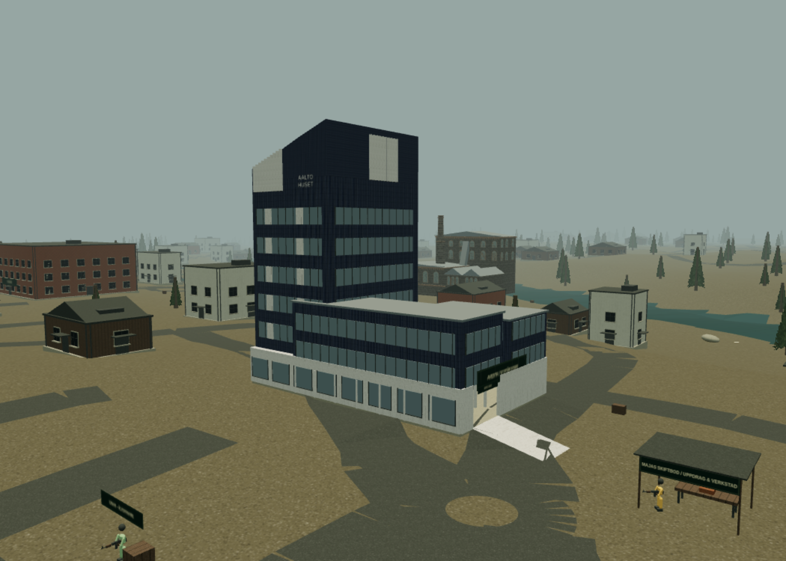
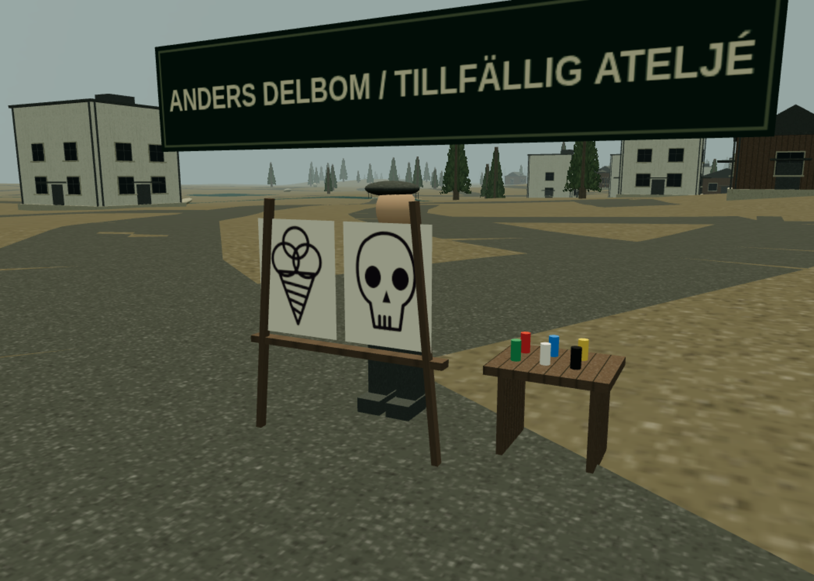

# Loot, utrustning och klassval — 0.5

## Bärga och handla

Vanliga fienders personliga fynd består av 10% vapen, 25% lösa vapendelar och 65% material. Bossar ger fortfarande ett legendariskt vapen. Fiender ger 5–12 brukskronor (bossar 100). Vapenförsäljning kräver att vapnet är avtaget och delarna demonterade. Köp-/säljpriser bestäms av servern; ett köpt föremål säljs för mindre än inköpspriset.

15 bärgningslådor finns vid landmärken och inne i Aaltohuset. **E** söker en synlig låda inom tre meter. Varje spelare kan söka varje låda en gång per karaktär, även efter offlineomstart. Lådorna ger ett fynd, 15 brukskronor och 5 skrot. Detta är en första, ändlig utforskningsbelöning; återkommande material kommer från fiender och handel. Lådor som redan sökts döljs för spelaren.

Maja och Torsten köper och säljer material, lösa vapendelar och vapen. De säljer även förbrukningsvaror och erbjuder materialbaserad tillverkning. De gamla skrottjänsterna finns kvar. Vapen tillverkas med både skrot och angivna råmaterial. Bruksingenjörens rabatt gäller skrotkostnaden.

Material: sten, trä, plast, järn, glas, elektronik, textil, gummi, kemikalier, koppartråd, fjädrar och lim. Alla ingår i recept. Elektronik kan återvinnas ur koppartråd, plast och glas. Fältförband återställer 70 hälsa; skyddsfilter och verktygssats ger tillfällig 30% skademinskning i 25 respektive 40 sekunder. Dessa skydd förlänger samma effekt och staplas inte med varandra. Granater kan tillverkas.

Kapacitet: 16 vapen, 24 lösa vapendelar, 999 per material, 10 per förbrukningsvara och 6 granater. Material och delar tar inte upp vapenplatser.

## Montera i packningen (I)

Välj först vapen med **Utrusta**, montera sedan en kompatibel del. En del per plats; den gamla delen återgår till packningen. Du kan demontera tillbaka den utan kostnad. Byte under omladdning blockeras. Ett större magasin skapar inte nya patroner direkt; ladda om med **R**.

| Plats      | Delar och funktion                                                                                                              |
| ---------- | ------------------------------------------------------------------------------------------------------------------------------- |
| Mynning    | Ljuddämpare: ljudets larmradie 80 → 25 m, skada −5%, ingen synlig mynningsflamma                                                |
| Undergrepp | Vertikalt grepp: rekyl −25%; vinklat grepp: spridning −30%; stativben: rekyl/spridning −55% när du står still, hukar och siktar |
| Magasin    | Större: +50% kapacitet, +20% omladdningstid; snabbt: −30% omladdningstid                                                        |
| Kolv       | Lätt: +8% fart, +15% rekyl; stabil: −28% rekyl, −6% fart                                                                        |
| Optik      | Rödpunkt, holografiskt och kikarsikten 2×, 4×, 6×; öppna modeller med sikt genom optiken                                        |
| Tillbehör  | Brukslampa: **L** tänder/släcker en riktad ljuskälla                                                                            |

Passform valideras per vapentyp. Optik påverkar kamerans synfält; det är inte en separat renderad bild i linsen. Rödpunktens interna synfältsfaktor är 1,25 och holografens 1,5. Rekyl avser den befintliga visuella vapenrörelsen. Spridningsgrepp påverkar vapen som har spridning; precisionen hos ett redan helt exakt vapen förbättras inte ytterligare. Dämpare förhindrar inte att fiender ser dig eller larmas av en träff.

## Talanger och klasser

Varje nivå ger en poäng. Eldkraft, Livskraft och det nya trädet använder **samma** poängpool. Fältvana och Vapenmästare är två inledande vägar. Klassens stöd- och anfallsförmågor kostar två poäng, kräver respektive föregångare och utesluter varandra permanent för karaktären. Specialförmågan används med **Z**, medan **Q** behåller klassens grundförmåga. Specialförmågan har 40 sekunders återhämtning, eller 30 med Dalarnas mästare.

| Klass         | Specialvapen (10% snabbare omladdning) | Stödgren / anfallsgren                                                       |
| ------------- | -------------------------------------- | ---------------------------------------------------------------------------- |
| Stålvakt      | AK4, Ksp 58                            | Bastion: gruppskydd / Stålsalva: eldhastighet                                |
| Skogsvandrare | m/96                                   | Kamouflage: kortare upptäcktsradie tills du skjuter / Jaktfokus: gevärsskada |
| Kopparslagare | Hagel 12                               | Slaggsköld: personligt skydd / Brukets åska: förstärkt granat                |
| Älvvakt       | Kpist m/45                             | Broförsvar: gruppskydd / Forsrusning: fart utan uthållighetskostnad          |
| Fältvårdare   | m/40                                   | Fältsjukhus: full grupphälsa / Akutinsats: återuppliva fallen allierad       |
| Bruksingenjör | Ksp 58                                 | Reparationsfält: gruppskydd och läkning / Övertryck: vapenskada              |

Stålvakt och Bruksingenjör kan använda kulspruta och rustning 3 direkt. Övriga måste låsa upp Tung vapenträning respektive Bruksrustning. Dessa talanger ger också snabbare kulspruteladdning respektive ytterligare 4% skademinskning, så de är användbara även för de tunga klasserna. Vapenmästare ger +15% skada med klassens specialvapen; Fältvana ger +10% fart och +25% materialfynd avrundat uppåt. Klasserna behåller sina olika hälsovärden, grundhastigheter och tidigare förmågor.

## Aaltohuset

Östra entrén har en ramp. Bottenplanet består av reception och arkivrum med tre sökbara lådor. Evakueringsplanen i arkivskåpet kan lämnas till Maja en gång för 120 brukskronor och 100 XP. Övre våningar är ännu inte tillgängliga. Bottenplanets planlösning är fiktiv, byggd för spelet; fasaden utgår från ägarens bilder. Väggar och bjälklag stoppar skott och granater.

## Sparning och multiplayer

Gamla offlineprofiler version 1 läses fortfarande. Nya fält får tomma standardvärden. Material, valuta, modifikationer, sökta lådor, uppdrag och talangval sparas per klass. Okända delar och ogiltiga talangkedjor filtreras vid inläsning. Befintliga sparningar har inget retroaktivt materiallager; bärga, handla eller använd AdminL för utveckling.

Servern utför samma handlingar och kontrollerar avstånd, ägande, kompatibilitet, kapacitet, priser, recept och talangpoäng. Offlineprofiler laddas inte upp till multiplayer. Onlineframsteg gäller fortsatt bara den aktuella sessionen. AdminL kan nu även skapa material/vapendelar och ändra brukskronor. Klient och server ska uppdateras tillsammans till 0.6.

## Anders Delbom och sprayfärg

Anders är en stiliserad konstnärs-NPC med ett staffli där han ritar glassar och döskallar. Han säljer faluröd, dalablå, kurbitsgul, skogsgrön, kritvit och kolsvart sprayfärg för 25 brukskronor per burk. Välj färg och motiv i packningen med **I**, och spraya på fri mark framför spelaren med **B**. En burk ger ett motiv. Högst 10 burkar per färg och 24 aktiva målningar per spelare. Målningarna följer terrängen, syns för andra i samma rum och sparas i offlineprofilen. Väggmålning och frihandsteckning ingår ännu inte.

**Adressläget är provisoriskt.** Den önskade adressen är Axel Johnsons väg 117B. Miljöns proxy blockerade adressuppslagning med HTTP 403. Det sparade OSM-underlaget innehåller gatan, men inte den verifierade adresspunkten. NPC:n står därför vid en uttryckligen tillfällig ateljé på gatan, markerad på den stora kartan. `shared/artist.js` anger den använda vägkällan och `verified: false`. En bekräftad kartpunkt behövs för exakt placering vid 117B; det har inte påståtts att personen bor eller äger fastigheten där.

Anders dialog länkar till en Booli-sökning efter **Odlargränd 16, Avesta**. Booli kunde inte nås från utvecklingsmiljön (proxy HTTP 403), så **inget aktuellt fastighetsvärde har verifierats eller lagts in**. Detta är en länk för manuell kontroll, inte en liveintegration. Ett uppskattat marknadsvärde, ett slutpris och ett taxeringsvärde är olika uppgifter. En senare uppdatering ska ange källa och värderingsdatum om ett belopp läggs in.

## Fler klasstalanger i 0.6

Två nya passiva talanger och en taktisk förmåga på **X** per klass kompletterar stöd-/anfallsgrenarna. Regler, poängkrav och exakta effekter finns i [Kopparhjärta och klasser](STORY.md). Rena förband höjer fältförbandets läkning till 95; Kretsletare påverkar bärgade elektronik-/kopparmaterial, inte köpta föremål.
